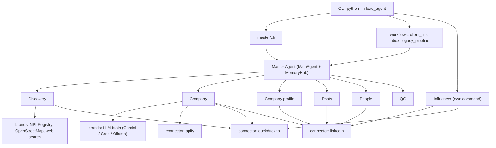

# Architecture: Master Agent and sub-agents

The `lead_agent` package is organised around one **Master Agent** that decides which specialised
**sub-agent** to call. Each sub-agent owns one job, its own provider clients ("brands"), its own
mini-orchestrator and its own private memory store. This document describes the layers, the dependency
rules and how to extend the system. For usage and commands see the root [README](../README.md).

## Layers

| Layer | Folder | Responsibility |
|---|---|---|
| Config | `lead_agent/config/` | `settings.py`: every project path (`ROOT`, `DATA_DIR`, `MEMORY_DIR`, `CACHE_DB`, `OUTPUT_DIR`, `INBOX_DIR`, `OUTBOX_DIR`, `SAMPLES_DIR`). No module computes paths from `__file__`; they import them from here. |
| Core | `lead_agent/core/` | Shared, brand-free building blocks: `utils` (polite HTTP + cache, robots.txt, US formatting), `enrichment` (crawl, industry score, email checks), `crm` (dedupe), `schema` (CSV columns, decision-maker pattern). |
| Connectors | `lead_agent/connectors/` | Shared external-service clients used by two or more agents: `duckduckgo`, `linkedin` (public, logged-out reader), `apify` (paid fallback, off by default). |
| Master | `lead_agent/master/` | The Master Agent: `main_agent` (`MainAgent`), `orchestrator` (`Step`, `MiniOrchestrator`), `memory` (`AgentMemory`, `MemoryHub`), `cli` (companies / posts / learn / memory). |
| Sub-agents | `lead_agent/sub_agents/<agent>/` | One folder per agent with `agent.py` and, where the agent has providers of its own, a `brands/` folder. `base.py` holds the shared `SubAgent` class. |
| Workflows | `lead_agent/workflows/` | User-facing pipelines that drive the master: `client_file` (Excel/CSV), `inbox` (folder watcher), `legacy_pipeline` (single-pass CSV run). |
| CLI | `lead_agent/__main__.py` | Single entry point `python -m lead_agent <command>`; forwards the arguments to the target `main()`. |

## Diagram

Every sub-agent sits on `master/orchestrator.py` (its mini-orchestrator) and writes to its own store through
`master/memory.py`; the diagram omits those edges for readability.

## Sub-agents

| Agent | Purpose | Folder | Brands / connectors used | Memory store |
|---|---|---|---|---|
| Discovery | Find candidate companies for an industry and city | `sub_agents/discovery/` | brands: `npi_registry`, `openstreetmap`, `web_search`; connector: `duckduckgo` | `data/memory/discovery.sqlite` |
| Company | One company: website, verification, people, decision-maker, email, score | `sub_agents/company/` | brands: `llm_brain` (Gemini / Groq / Ollama); connectors: `linkedin`, `apify`, `duckduckgo` | `data/memory/company.sqlite` |
| Company profile | LinkedIn public company page (size, etc.) | `sub_agents/company_profile/` | connector: `linkedin` | `data/memory/company-profile.sqlite` |
| Posts | LinkedIn public posts and comments | `sub_agents/posts/` | connector: `linkedin` | `data/memory/posts.sqlite` |
| People | Look up a person's LinkedIn profile and headline | `sub_agents/people/` | connector: `linkedin` | `data/memory/people.sqlite` |
| QC | Lead score and decision-maker flag | `sub_agents/qc/` | none | `data/memory/qc.sqlite` |
| Influencer | Track public posts of LinkedIn profiles listed in a file (standalone command) | `sub_agents/influencer/` | connectors: `linkedin`, `duckduckgo` | none |

The Master Agent keeps a further store, `data/memory/main.sqlite` (run history). Only the Master Agent holds the
`MemoryHub`; each sub-agent receives only its own `AgentMemory`.

## Import rules

1. **Sub-agents never import each other.** An agent's code must not import another agent's `agent.py`.
2. **Only `master/` and `workflows/` coordinate agents.** They are the only layers that import several agents
   and decide the order of calls.
3. **Shared external services live in `connectors/`.** If two or more agents need the same provider, it belongs there.
4. **Agent-only providers live in `sub_agents/<agent>/brands/`.** If a provider is used by one agent only, keep it
   inside that agent's folder.
5. **`core/` and `config/` are brand-free** and import neither agents, connectors nor workflows (one exception:
   `core/crm.py` lazily imports `FieldMapper` from `workflows/client_file`).
6. Imports are absolute (`from lead_agent.core.utils import fetch`). Project paths come from `lead_agent.config.settings`.

### Current exceptions (to clean up)

The code predates rules 1 and 4 in a few places. These imports cross agent folders and should move to
`connectors/` or `core/` when they are next touched:

- `company/agent.py` and `company/site_finder.py` import `in_area`, `find_linkedin_people` and `web_search`
  from `discovery/brands/`.
- `discovery/agent.py` imports `merge` from `company/site_finder.py`.
- `master/main_agent.py` imports `geocode_point` / `in_area` from `discovery/brands/openstreetmap.py` and
  `industry_off` from `company/site_finder.py` (acceptable: master may use agent internals).

## Checklist: add a new sub-agent

1. Create `lead_agent/sub_agents/<name>/` with `__init__.py` (one-line docstring) and `agent.py`.
2. Subclass `SubAgent` from `sub_agents/base.py`, set `name`, and return a list of `Step` objects from `steps()`
   (`when`, `stop`, `reorder` as needed; see `master/orchestrator.py`).
3. Add a short `README.md` in the folder (role, inputs/outputs, steps, brands, memory store).
4. Register the agent in `MainAgent` (`master/main_agent.py`): add its name to `AGENTS` (this creates its memory
   store `data/memory/<name>.sqlite`), instantiate it, and decide where the master calls it.
5. Use only `connectors/`, `core/`, `config/` and its own `brands/`. Do not import another agent.
6. If it needs a CLI entry, add a subcommand in `master/cli.py`, or a command entry in `lead_agent/__main__.py`
   (`COMMANDS`) for a standalone or workflow command.
7. Document the command in the root `README.md` and add a row to the sub-agent table above.

## Checklist: add a new brand (provider)

1. Decide the scope. Used by one agent: `sub_agents/<agent>/brands/<brand>.py`. Used by two or more:
   `connectors/<brand>.py`.
2. Keep it a thin client: fetch through `core.utils.fetch` (cache, throttle, robots.txt) and return plain dicts.
   Read credentials from environment variables; never hard-code keys.
3. Paid or rate-limited providers must be opt-in (a flag, as `--apify`) and cached.
4. Add it as a `Step` in the owning agent, so the mini-orchestrator can skip or reorder it by learned success rate.
5. Document the provider and any environment variable in the root `README.md` and in the agent's `README.md`.
